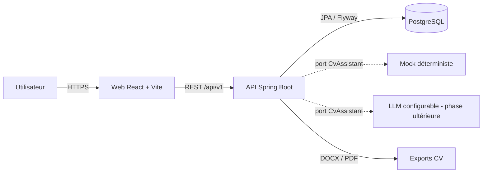
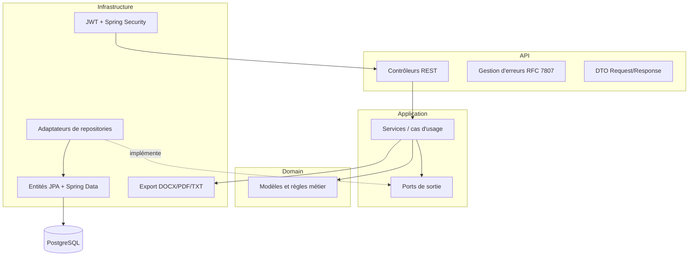
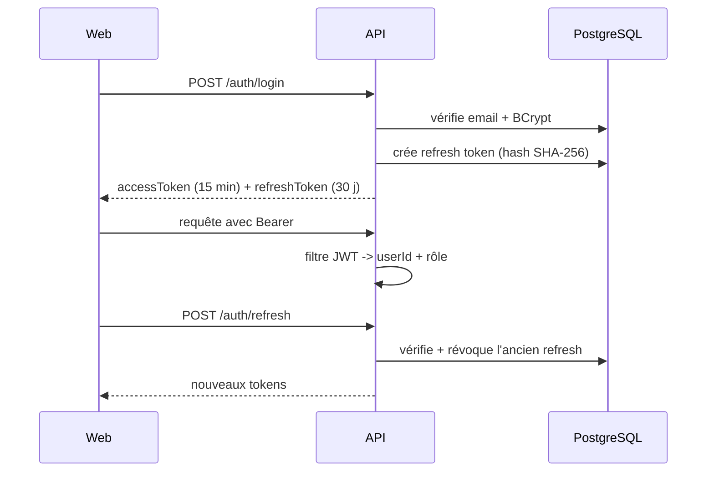
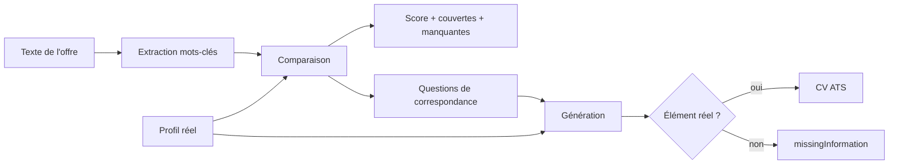
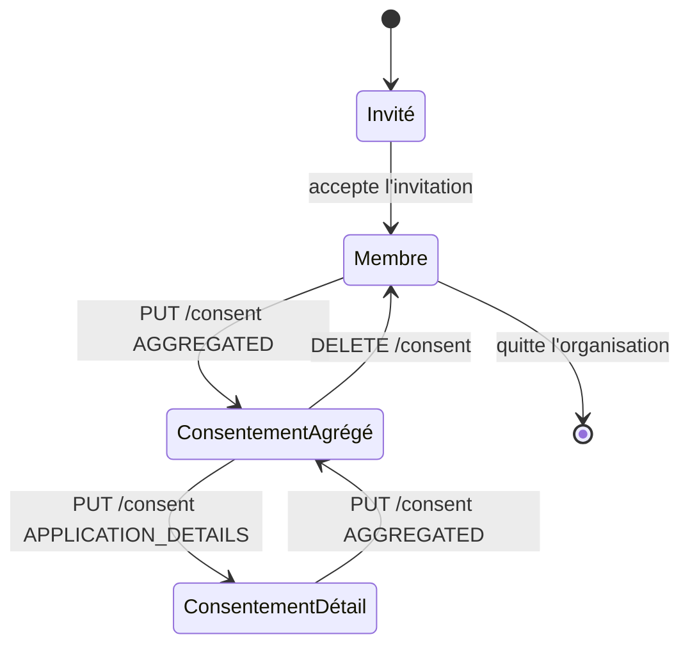
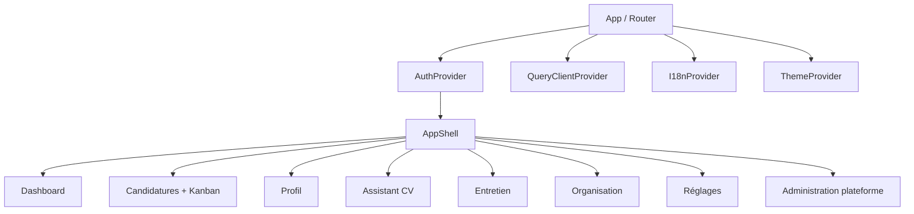
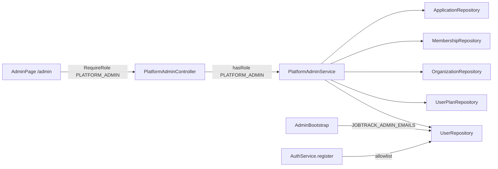

# JobTrack — Architecture technique

## 1. Vue d'ensemble

## 2. Architecture backend (hexagonale légère)

**Règle de dépendance** : `api → application → domain`, `infrastructure → application/domain`. Le domaine ne connaît ni Spring ni JPA.

## 3. Modèle de données

```mermaid
erDiagram
  USERS ||--|| USER_PROFILES : possède
  USERS ||--|| USER_PLANS : possède
  USERS ||--o{ REFRESH_TOKENS : possède
  USERS ||--o{ APPLICATIONS : possède
  USERS ||--o{ CONTACTS : possède
  USERS ||--o{ PROFILE_EXPERIENCES : possède
  USERS ||--o{ PROFILE_EDUCATIONS : possède
  USERS ||--o{ PROFILE_PROJECTS : possède
  USERS ||--o{ PROFILE_SKILLS : possède
  USERS ||--o{ PROFILE_LANGUAGES : possède
  USERS ||--o{ GENERATED_CVS : possède
  USERS ||--o{ ORGANIZATION_MEMBERSHIPS : adhère
  ORGANIZATIONS ||--o{ ORGANIZATION_MEMBERSHIPS : contient
  ORGANIZATIONS ||--o{ ORGANIZATION_GROUPS : contient
  ORGANIZATIONS ||--o{ ORGANIZATION_CONSENTS : reçoit
  ORGANIZATIONS ||--o{ ORGANIZATION_INVITATIONS : émet
  ORGANIZATION_GROUPS ||--o{ ORGANIZATION_GROUP_MEMBERS : contient
  APPLICATIONS ||--o{ APPLICATION_STATUS_HISTORY : historise
  APPLICATIONS ||--o{ INTERACTIONS : contient
  APPLICATIONS ||--o{ REMINDERS : contient
  APPLICATIONS }o--|| CONTACTS : référence
  APPLICATIONS ||--o{ GENERATED_CVS : utilise
```

### Entités principales
- `applications` : entreprise, poste, lieu, mode de travail, contrat, salaire, source, URL, statut, dates, notes, contact, CV généré.
- `application_status_history` : historique horodaté de chaque changement de statut.
- `contacts` : nom, rôle, LinkedIn, e-mail.
- `interactions` : message, relance, entretien, appel, e-mail, note.
- `reminders` : titre, échéance, complété.
- `generated_cvs` : contenu JSONB, offre source, candidature liée, score.
- `organizations`, `organization_memberships`, `organization_groups`, `organization_group_members`, `organization_consents`, `organization_invitations`.
- `user_plans` : plan, quota, date de réinitialisation.

## 4. Flux d'authentification

## 5. Flux CV avec garde-fous

- Aucune expérience, compétence, date ou diplôme inventé.
- Chaque élément généré est issu du profil.
- Le mock est déterministe ; l'implémentation LLM est derrière le même port.

## 6. Espace organisation et consentement

- L'organisation ne voit que les agrégats sans consentement.
- Le détail des candidatures exige `APPLICATION_DETAILS`.
- Le membre peut révoquer ou quitter l'organisation et conserver ses données.

## 7. Découpage frontend

Chaque feature contient : `api.ts` (appels typés), `hooks.ts` (TanStack Query), `types.ts`, pages et composants.

## 8. Administration plateforme

- Le contrôle d'accès est double : `SecurityConfig` protège `/api/v1/admin/**`
  et `RequireRole` protège la route frontend `/admin` (redirection sinon).
- `AdminAllowlist` est un port d'application implémenté par configuration
  (`ConfiguredAdminAllowlist`), sans e-mail codé en dur.
- Aucune entité JPA n'est exposée : le service agrège et renvoie des vues.
- La création de compte depuis la console réutilise `PasswordHasher` et initialise
  profil vide + plan `FREE`, comme `AuthService.register`.
- Garde-fous métier dans le service : auto-rétrogradation interdite (`400`),
  dernier administrateur protégé (`409`).

## 9. Décisions et limites
- LLM : non branché dans cette itération. Le port `CvAssistant` permet d'ajouter un fournisseur via variables d'environnement sans changer le domaine. Le fournisseur reste une décision produit.
- Paiement : hors scope. Les plans existent dans le modèle, sans facturation.
- Notifications : rappels visibles dans l'application ; pas d'envoi e-mail.
- Stockage des tokens : `localStorage` pour le MVP ; à remplacer par cookies httpOnly + CSRF en production.
